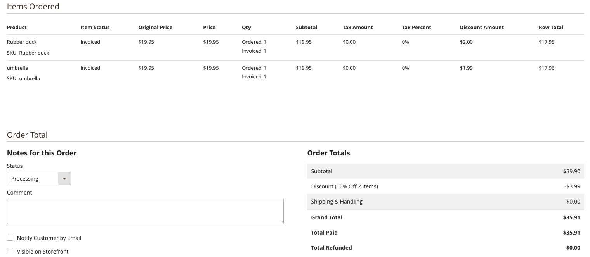

# 创建购物车价格规则

购物车价格规则会根据您设置的条件，对购物车中的商品应用折扣。 当满足条件或客户输入有效优惠券代码时，将应用折扣。 折扣显示在小计下的购物车中。 通过更改其状态和日期范围，为季节或促销活动打开或关闭规则。

## 此视频面向谁？

* 电子商务营销人员
* 网站管理员

## 视频内容

* 创建购物车价格规则和可选优惠券代码。
* 了解折扣在购物车中的显示方式以及促销情况。

>[!VIDEO](https://video.tv.adobe.com/v/343835?learn=on)

## 定价显示问题

显示的行项目折扣有时会因舍入而有所不同。 当购物车价格规则在多个产品中应用一个折扣，并且拆分生成具有两个以上小数位的金额时，就会出现此差异。

>[!BEGINSHADEBOX]

购物车价格规则=对购物车中2个产品应用了10%的折扣
价格规则生效的条件：购物车中的项目总数为2
操作应用产品价格折扣的百分比，且折扣金额为10

购物车中添加了2个项目，每个项目的价格为19.95美元

要获得折扣额乘以产品价格0.1

19.95 x 0.1 = 1.995

这就是问题所在，我们有3位小数，而不是2位。 将这笔钱兑换成美元现在成了一个问题

>[!ENDSHADEBOX]

### 解决方案

对于Admin中的商家来说，最明确的方法是显示每个订购行的美元折扣。 要保持订单总计正确，请将第一行项目向上四舍五入，并将第三个小数点放在剩余的行项目上。 查看此方案：

>[!BEGINSHADEBOX]

与上面生效的购物车规则相同的10%折扣
将2种产品(19.95)添加到购物车

每件产品可获得1.995美元的折扣
产品1 - 19.95 x 0.1 = 1.995
2 - 19.95 x 0.1 = 1.995

总共3.99元作为客户的折扣

在管理员中向商店所有者显示行项目时，
我们需要调整第一个项目并将其四舍五入到2.000。 对于第二项，删除第三个小数。
产品1 = 2.00
产品2 = 1.99

这两种产品的合计总折扣现在与提供给客户的实际折扣匹配。
>[!ENDSHADEBOX]

下面的管理员屏幕截图显示了此示例的行项目折扣：

### 其他可能的解决方案以及未使用它们的原因

>[!BEGINSHADEBOX]

与上面生效的购物车规则相同的10%折扣
将2种产品(19.95)添加到购物车

每个产品可获得1.995美元的折扣，
然而，如果我们只是把它们围起来，就会显示太多的折扣。

产品1 - 19.95 x 0.1 = 1.995
产品2 - 19.95 x 0.1 = 1.995

转换为对所有项目进行向上舍入
产品1新值为2.00
产品2新值为2.00

实际提供给客户的3.99毛额为折扣，
但是，如果我们汇总，就会显示4.00美元已经提供，这是不正确的。

2.00 + 2.00 = $4.00

>[!ENDSHADEBOX]

删除所有项目的第三个小数会产生太小的总折扣。

>[!BEGINSHADEBOX]

与上面生效的购物车规则相同的10%折扣
将2种产品(19.95)添加到购物车

每个产品应获得1.995美元的折扣，但如果我们只舍弃小数点后三位，就会出现以下情况：
产品1 - 19.95 x 0.1 = 1.995
产品2 - 19.95 x 0.1 = 1.995

转换为拖放所有项目的第三个小数
产品1新值为1.99
产品2新值为1.99

实际提供给客户的3.99毛额为折扣，
但是，如果我们舍弃小数点后三位，则会显示$3.98已提供，并且不正确。

1.99 + 1.99 = $3.98

>[!ENDSHADEBOX]

## 其他资源

* [创建购物车价格规则 —  [!DNL Commerce] 促销和促销指南](https://experienceleague.adobe.com/zh-hans/docs/commerce-admin/marketing/promotions/cart-rules/price-rules-cart-create){target="_blank"}
* [优惠券代码 —  [!DNL Commerce] 销售和促销指南](https://experienceleague.adobe.com/zh-hans/docs/commerce-admin/marketing/promotions/cart-rules/price-rules-cart-coupon){target="_blank"}
